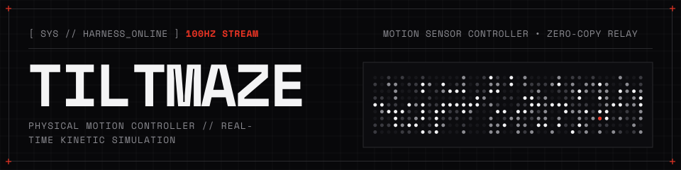
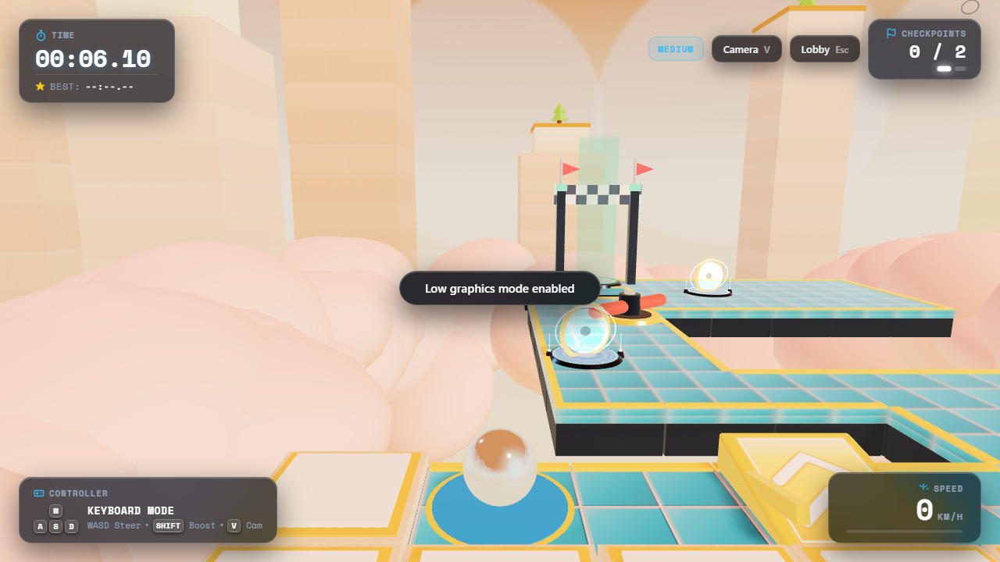
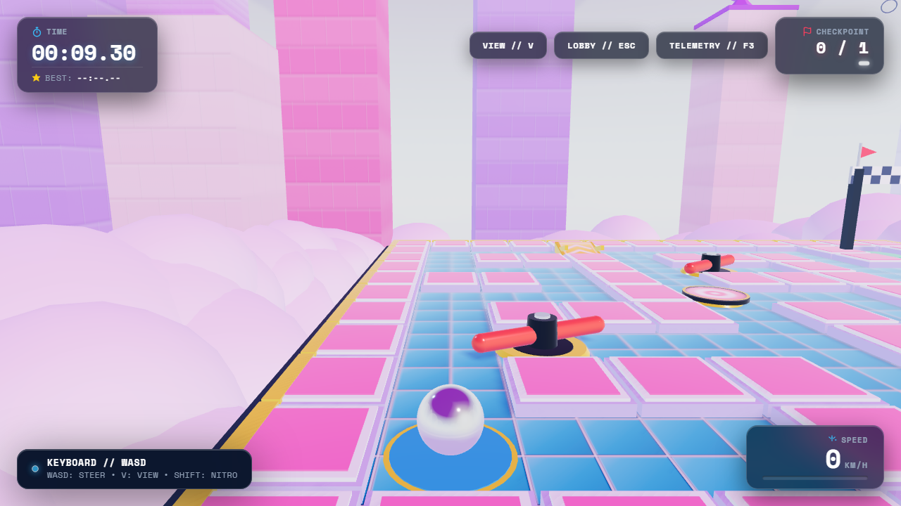
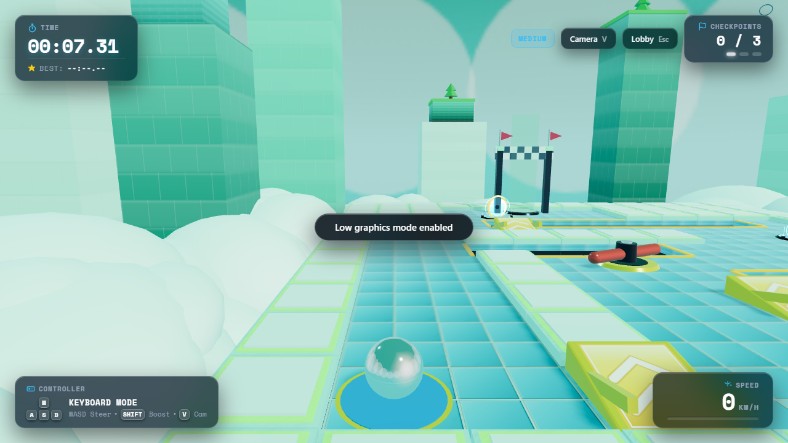
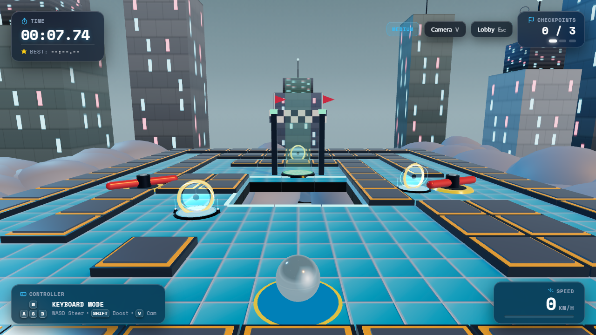
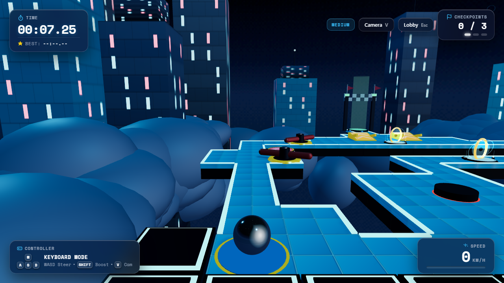

<p align="center">
  
</p>

<p align="center">
  A 3D motion-controlled marble platformer. Your smartphone acts as the physical balancing tray, streaming high-frequency IMU telemetry over WebSockets to steer a chrome marble across suspended skyways in the browser.
</p>

---

## Table of Contents

- [Overview](#overview)
- [System Requirements](#system-requirements)
- [Quick Start](#quick-start)
  - [Windows (One-Click)](#windows-one-click)
  - [Manual Setup (Cross-Platform)](#manual-setup-cross-platform)
  - [Development Mode](#development-mode)
- [Android Controller Setup](#android-controller-setup)
  - [Option A: GitHub Releases (Recommended)](#option-a-github-releases-recommended)
  - [Option B: Direct Local Download](#option-b-direct-local-download)
  - [Option C: Build from Source](#option-c-build-from-source)
- [Pairing and Calibration](#pairing-and-calibration)
- [Controls](#controls)
  - [Phone Motion Controller](#phone-motion-controller)
  - [Keyboard Fallback](#keyboard-fallback)
- [Difficulty Modes](#difficulty-modes)
- [Campaign Courses](#campaign-courses)
- [Architecture & Implementation](#architecture--implementation)
  - [Sensor Fusion and 1€ Adaptive Filter](#sensor-fusion-and-1-adaptive-filter)
  - [Rotated Gravity Tensor (Rapier 3D)](#rotated-gravity-tensor-rapier-3d)
  - [Contiguous Floor Collider Merging](#contiguous-floor-collider-merging)
  - [Compact Binary Telemetry Protocol](#compact-binary-telemetry-protocol)
- [Side Note: Nothing Phone Glyph Matrix](#side-note-nothing-phone-glyph-matrix)
- [Troubleshooting](#troubleshooting)
- [Repository Structure](#repository-structure)
- [License](#license)

---

## Overview

Traditional maze and marble games rely on touch joysticks or analog sticks. Tiltmaze returns to the tactile feel of physical wooden labyrinth games: you hold your smartphone flat, and physical tilts directly steer the virtual marble.

The companion Android app samples device rotation at 100 Hz, filters physiological hand tremor with an adaptive 1€ filter, packs calibrated orientations into compact 20-byte binary packets, and streams them over low-latency local WebSockets to the web client. The web game runs on Three.js (WebGL2) and Rapier 3D physics compiled to WebAssembly.

---

## System Requirements

- **Computer / Host:**
  - Node.js 18.0.0 or higher (tested on Node 20 and Node 22)
  - npm 9.0.0 or higher
  - Modern web browser with WebGL2 and Web Audio API support (Chrome, Edge, Firefox, Brave, Safari)
- **Phone / Controller:**
  - Android 8.0 or higher (API level 26+)
  - Hardware accelerometer and gyroscope (rotation vector sensor)
  - Connected to the same local Wi-Fi network as the computer

---

## Quick Start

### Windows (One-Click)

1. **Download the project:** Click the green **Code** button at the top of this GitHub repository and select **Download ZIP**, then extract the downloaded ZIP archive (or clone via `git clone https://github.com/tezz-e/tile-maze.git`).
2. **Launch:** Open the extracted folder and double-click `start.bat` (or run `.\start.bat` from PowerShell / Command Prompt).
3. The script automatically verifies Node.js, installs dependencies if `node_modules` is missing, compiles the shared protocol, server, and game client, launches the relay server, and opens `http://localhost:3000` in your default browser.

### Manual Setup (Cross-Platform)

For macOS, Linux, or manual terminal execution:

1. Clone the repository and enter the directory:
   ```bash
   git clone https://github.com/tezz-e/tile-maze.git
   cd tile-maze
   ```

2. Install dependencies:
   ```bash
   npm install
   ```

3. Build all workspace packages (shared protocol, relay server, and game client):
   ```bash
   npm run build
   ```

4. Start the server:
   ```bash
   npm start
   ```

5. Open `http://localhost:3000` in your browser. The lobby displays your computer's local network IP, active port, a 4-letter room pairing code, and a QR code for your phone.

### Development Mode

To run the server and game client with concurrent hot-reloading and source watching:
```bash
npm run dev
```

---

## Android Controller Setup

### Option A: GitHub Releases (Recommended)

Pre-built APK binaries are generated automatically by GitHub Actions CI for every release:

1. Navigate to the [Releases](https://github.com/tezz-e/tile-maze/releases/tag/latest) page of this repository.
2. Download `Tiltmaze-Controller.apk`.
3. Open the downloaded file on your Android device to install (allow "Install unknown apps" if prompted).

### Option B: Direct Local Download

When the server is running on your computer:

1. Connect your phone to the same Wi-Fi network.
2. In your mobile browser, navigate to:
   ```text
   http://<your-computer-ip>:3000/apk
   ```
   *(You can also tap the "Download APK" link directly in the web game lobby).*
3. Install the downloaded APK.

### Option C: Build from Source

Prerequisites: JDK 17+ and the Android SDK (API 34).

1. Navigate to the `app/` directory:
   ```bash
   cd app
   ```
2. Build the debug APK using the Gradle wrapper:
   - On Windows:
     ```cmd
     gradlew.bat assembleDebug
     ```
   - On macOS / Linux:
     ```bash
     chmod +x gradlew
     ./gradlew assembleDebug
     ```
3. The compiled APK will be located at:
   `app/app/build/outputs/apk/debug/app-debug.apk`
4. If your phone is connected via USB with USB debugging enabled, install it directly:
   ```bash
   adb install -r app/build/outputs/apk/debug/app-debug.apk
   ```

---

## Pairing and Calibration

1. Open the **Tiltmaze** app on your phone.
2. **Pairing:**
   - Tap **Scan Laptop QR Code** and point your phone camera at the QR code displayed on your computer screen.
   - Alternatively, enter the computer's IP (e.g. `192.168.1.15:3000`) and the 4-letter room code manually, then tap **Connect**.
3. **Neutral Calibration:**
   - Once connected, hold your phone in whatever posture feels natural and comfortable.
   - Tap **Calibrate**. The controller records your orientation over a 300ms window and sets that angle as the virtual level plane. You can re-calibrate at any point during gameplay without leaving the course.
4. **Connection State:**
   - If the connection drops or the phone app enters the background, the web game automatically pauses physics and displays a reconnection overlay. When the controller reconnects, gameplay resumes seamlessly.

---

## Controls

### Phone Motion Controller

| Action | Gesture / Input | Description |
| :--- | :--- | :--- |
| **Roll / Steer** | Physical Tilt | Tilting pitch and roll dynamically accelerates the marble along the track. |
| **Jump** | Upward Wrist Flick | Rapid upward acceleration hops the marble across open-air gaps. |
| **Nitro Boost** | Hold Nitro Button | Applies forward propulsion for high-speed straightaways. |
| **Brake** | Hold Brake Button | Dampens marble velocity to prevent flying off un-walled corners. |
| **Calibrate** | Tap Calibrate Button | Sets the current phone orientation as neutral horizontal level. |

### Keyboard Fallback

The web game includes full keyboard controls for local testing without an Android device. Select **Play with Keyboard** on any level card in the lobby:

| Key | Action |
| :--- | :--- |
| `W`, `A`, `S`, `D` or `Arrow Keys` | Steer marble (simulates board tilt) |
| `Spacebar` | Jump over air gaps |
| `Shift` | Nitro speed boost |
| `B` | Brake velocity dampener |
| `V` | Cycle camera view (Standard Chase vs. Cinematic Close Follow) |
| `C` | Recalibrate neutral tilt |
| `Esc` | Return to Lobby |

---

## Difficulty Modes

Difficulty can be selected in the lobby prior to starting any level. The underlying track geometry remains identical across all modes, while collision boundaries and obstacle speeds adapt dynamically:

| Mode | Mechanism | In-Game Behavior |
| :--- | :--- | :--- |
| **Easy** | Safety Guardrails | Walkable edges bordering an abyss spawn 2.8m physical box colliders and translucent glowing acrylic rails. Intentional jump gaps remain open. The marble cannot fall into the void. |
| **Medium** | Authentic Skyway | True open-valley drops on sweeping exits, narrow 2-cell ridges, and jump gaps. Key sharp turns retain selective catch-walls. |
| **Hard** | Pro Labyrinth | Completely un-walled ridges, strict championship par times, and turnstile rotors spinning 25% faster (`speed * 1.25`). |

---

## Campaign Courses

The campaign consists of 6 progressive courses, each introducing new physics elements, track geometries, and lighting profiles:

| Course | Subtitle | Key Mechanics & Edge Geometry | Gold Par |
| :--- | :--- | :--- | :---: |
| **01 • Skyway Runway** | The Teaser | 2-cell runway with walled entry, an open chicane overlooking the clouds, and an air gap leap over the abyss directly onto the Goal platform. | 00:20.00 |
| **02 • Serpent's Ridge** | The Elevated Spine | Narrow 2-cell winding spine flanked by open drop-offs. Catch-walls protect only the first S-turn apex; the second turn and rotor bridge are completely open. | 00:26.00 |
| **03 • Twin Paths** | Island Shortcut | Safe winding corridor (25 steps) versus a disconnected sky-island leap across open void (22 steps) launching from a spring bouncer pad. | 00:35.00 |
| **04 • Kinetic Speedway** | High-Speed Tangents | Long boost pad straightaways into sweeping corners where the exit opens into raw abyss, requiring disciplined counter-tilting or braking. | 00:44.00 |
| **05 • Vortex Valley** | Central Chasm Spiral | Atmospheric storm sky with ambient lightning. The track spirals inward around a massive central chasm, ending with a narrow bridge onto the Goal island. | 00:58.00 |
| **06 • Master's Labyrinth** | Championship Climax | Stepping-stone islands, dual kinematic rotors, and the Blackout Sanctum finale where ambient lights dim, leaving only cyan neon edge strips tracing the razor ridge. | 01:16.00 |

### Course Previews

| Course 01: Skyway Runway | Course 02: Serpent's Ridge |
| :---: | :---: |
|  |  |

| Course 03: Twin Paths | Course 04: Kinetic Speedway |
| :---: | :---: |
|  |  |

| Course 05: Vortex Valley | Course 06: Master's Labyrinth |
| :---: | :---: |
|  |  |

---

## Architecture & Implementation

```
Phone (Android IMU)
  └─ TYPE_GAME_ROTATION_VECTOR @ 100 Hz
  └─ 1€ Adaptive Jitter Filter (1.0 Hz - 30.0 Hz)
  └─ 20-Byte Compact Binary Frame @ 60 Hz
       │
       ▼ (WebSocket over Local Wi-Fi)
Server (Node.js Relay on :3000)
  └─ Room management & zero-copy packet relay
  └─ Static web game host & /apk distribution
       │
       ▼
Browser (Three.js + Rapier 3D WASM)
  └─ Rotated Gravity Tensor (track remains fixed, gravity rotates)
  └─ Contiguous Floor Collider Rectangles (prevents seam catching)
  └─ Procedural Web Audio synthesizer for rolling friction & impacts
```

### Sensor Fusion and 1€ Adaptive Filter

Raw smartphone IMU sensors contain physiological hand tremor at rest and phase delay during fast motion. The Android app runs incoming rotation vector readings through an implementation of the **1€ (One-Euro) Filter**:
- **Low Angular Velocity:** The cutoff frequency drops toward $f_{min} = 1.0\text{ Hz}$, eliminating micro-tremor when holding the phone still.
- **High Angular Velocity:** During rapid wrist movements, the cutoff frequency dynamically expands up to $30.0\text{ Hz}$ ($\beta = 0.007$), eliminating phase lag and keeping controls responsive.
- **Relative Quaternion Calibration:** The app records the neutral resting quaternion $q_{ref}$ over a 300ms window and computes relative orientation via quaternion conjugation:
  $$q_{rel} = q_{ref}^* \otimes q_{curr}$$
  This avoids gimbal lock and ensures players can hold the device at whatever angle feels natural.

### Rotated Gravity Tensor (Rapier 3D)

Rather than physically tilting the entire 3D level geometry in Three.js (which can introduce collision tunneling, visual jitter, and camera instability), the skyway track remains static at $y = 0$. Calibrated phone pitch and roll are translated into a dynamically rotated global gravity vector in Rapier 3D:
$$\vec{g}_{effective} = \begin{bmatrix} -g \sin(\text{roll}) \\ g \cos(\text{pitch})\cos(\text{roll}) \\ g \sin(\text{pitch}) \end{bmatrix}$$
This preserves accurate rolling inertia, momentum conservation, and centrifugal forces on banked curves.

### Contiguous Floor Collider Merging

In a physics engine, placing individual 1×1 tile box colliders side-by-side causes internal-edge seam bounces when a rolling sphere crosses boundaries. Tiltmaze implements a 2D rectangular decomposition algorithm (`mergeFloorTiles` in `PhysicsWorld.ts`) that combines contiguous walkable cells along rows and rectangles into larger unified box colliders, ensuring the 0.64m marble rolls smoothly without catching on internal seams.

### Compact Binary Telemetry Protocol

Motion telemetry is streamed over WebSockets using a zero-copy 20-byte binary frame structure:

```text
 0                   1                   2                   3
 0 1 2 3 4 5 6 7 8 9 0 1 2 3 4 5 6 7 8 9 0 1 2 3 4 5 6 7 8 9 0 1
+-+-+-+-+-+-+-+-+-+-+-+-+-+-+-+-+-+-+-+-+-+-+-+-+-+-+-+-+-+-+-+-+
|  Type (0x01)  |  Player Slot  | Button Bitmask|  Sequence No  |
+-+-+-+-+-+-+-+-+-+-+-+-+-+-+-+-+-+-+-+-+-+-+-+-+-+-+-+-+-+-+-+-+
|                   Calibrated Pitch (Float32 LE)               |
+-+-+-+-+-+-+-+-+-+-+-+-+-+-+-+-+-+-+-+-+-+-+-+-+-+-+-+-+-+-+-+-+
|                   Calibrated Roll  (Float32 LE)               |
+-+-+-+-+-+-+-+-+-+-+-+-+-+-+-+-+-+-+-+-+-+-+-+-+-+-+-+-+-+-+-+-+
|                   Azimuth / Yaw    (Float32 LE)               |
+-+-+-+-+-+-+-+-+-+-+-+-+-+-+-+-+-+-+-+-+-+-+-+-+-+-+-+-+-+-+-+-+
|                 Client Timestamp (Uint32 LE, ms)              |
+-+-+-+-+-+-+-+-+-+-+-+-+-+-+-+-+-+-+-+-+-+-+-+-+-+-+-+-+-+-+-+-+
```

- **Type (uint8):** Packet identifier (`0x01` for IMU telemetry).
- **Player Slot (uint8):** Player identification index.
- **Button Bitmask (uint8):** Bit 0 = Nitro Boost, Bit 1 = Jump, Bit 2 = Brake.
- **Sequence Number (uint8):** Wraparound index for tracking packet arrival and jitter.
- **Calibrated Pitch / Roll / Yaw (Float32 LE):** Filtered angles in radians.
- **Client Timestamp (Uint32 LE):** Millisecond timestamp for clock skew and latency monitoring.

---

## Side Note: Nothing Phone Glyph Matrix

While building the companion app, I noticed the Nothing Phone has an addressable LED matrix on the back. So because why not, I hooked up the Glyph SDK:
- A 3×3 LED dot mirrors the marble's position across the rear glass while you tilt.
- Radar sweeps fire during the QR code pairing sequence.
- Celebration strobes illuminate upon crossing the finish line.

It is an optional bonus for Nothing Phone users; standard Android devices simply use the cockpit screen and haptic motors.

---

## Troubleshooting

### Connection & Networking Issues

- **Phone cannot reach computer:**
  - Verify that both devices are connected to the exact same Wi-Fi router.
  - Check for **Access Point (AP) Isolation** or client isolation on your router (common on university or public networks). If AP isolation is enabled, devices cannot communicate directly; create a mobile Wi-Fi hotspot from your phone and connect your computer to it.
- **Windows Firewall blocking port 3000:**
  - When running `start.bat` or `npm start` for the first time, Windows Defender may ask for network permissions. Select **Allow on Private Networks**.
  - To manually permit traffic, open PowerShell as Administrator and run:
    ```powershell
    New-NetFirewallRule -DisplayName "Tiltmaze Relay Server" -Direction Inbound -LocalPort 3000 -Protocol TCP -Action Allow
    ```
- **Camera permission denied for QR scanning:**
  - If you decline camera permissions, you can enter the computer IP and 4-letter room code manually in the input fields on the app home screen.

### Calibration & Sensor Drift

- **Marble rolls when holding phone level:**
  - Hold the phone in your natural resting hand position and tap **Calibrate**. The system zeroes out your current holding angle.
  - If drift persists, lay the phone on a flat surface and tap Calibrate to reset the sensor baseline.

---

## Repository Structure

```text
.
├── .github/workflows/
│   └── build-and-release.yml      # CI/CD: Automated build, test, and release pipeline
├── app/                           # Android Kotlin companion app
│   ├── app/src/main/
│   │   ├── java/com/tiltmaze/     # Sensor manager, 1€ filter, Glyph LED driver, haptics
│   │   ├── res/                   # Adaptive launcher icon & Nothing OS vector resources
│   │   └── AndroidManifest.xml
│   └── gradlew                    # Gradle wrapper
├── packages/
│   └── protocol/                  # Shared TypeScript binary protocol definitions & codecs
├── server/                        # Express HTTP server & WebSocket relay (:3000)
├── game/                          # Three.js + Rapier 3D browser client
│   ├── src/
│   │   ├── audio/                 # Procedural Web Audio synthesizer
│   │   ├── input/                 # Keyboard controller
│   │   ├── levels/                # 6 campaign courses and par times
│   │   ├── physics/               # Rapier 3D world, rotated gravity, collider merging
│   │   ├── ui/                    # Lobby UI, HUD, and mobile pairing flow
│   │   └── world/                 # Track meshes, materials, and environment
│   └── test/                      # Vitest test suite
├── docs/                          # Screenshots, logo, and documentation media
├── start.bat                      # Windows one-click startup script
└── package.json                   # Root workspace configuration
```

---

## License

This project is licensed under the MIT License - see the [LICENSE](LICENSE) file for details.
