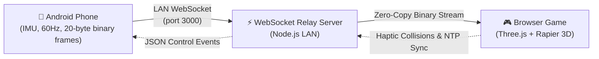
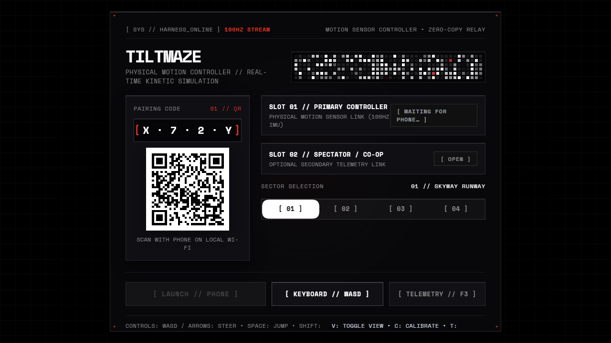
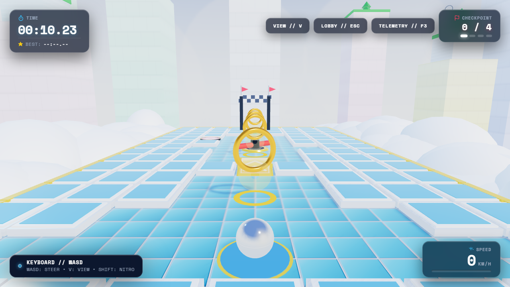
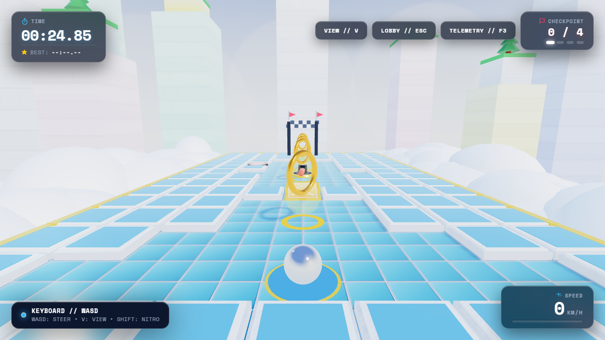
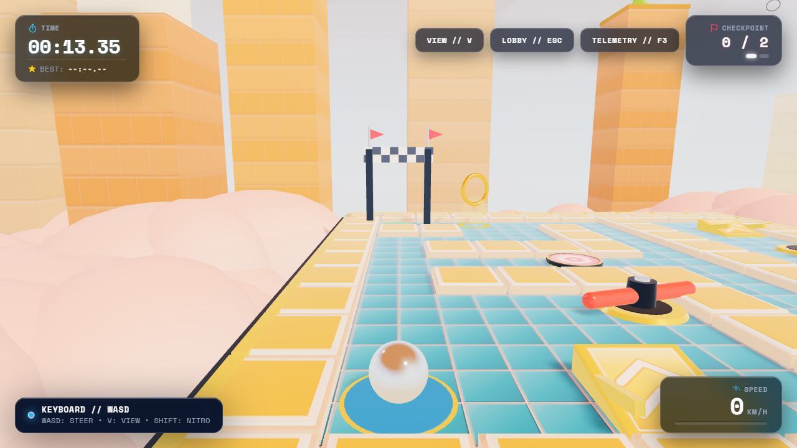
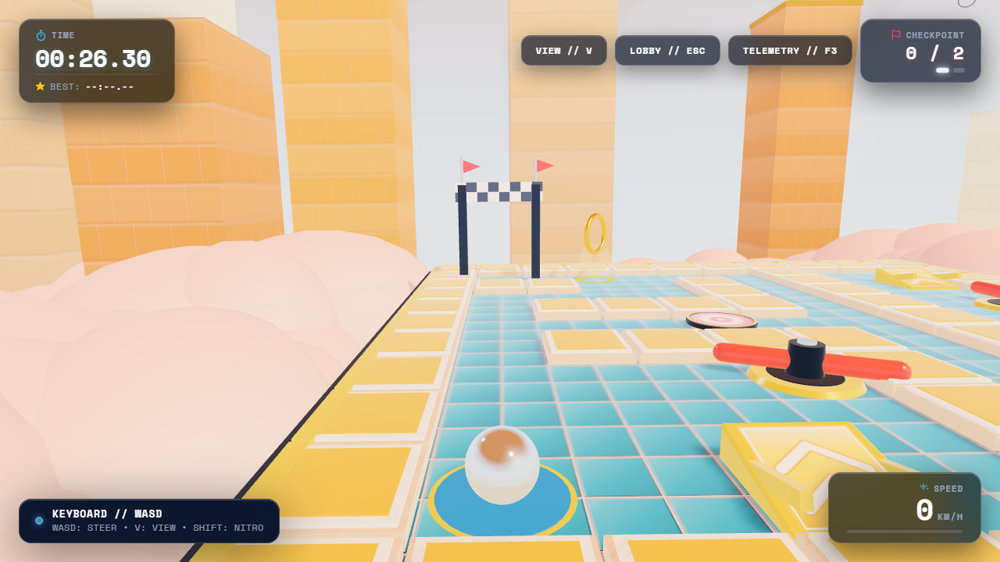
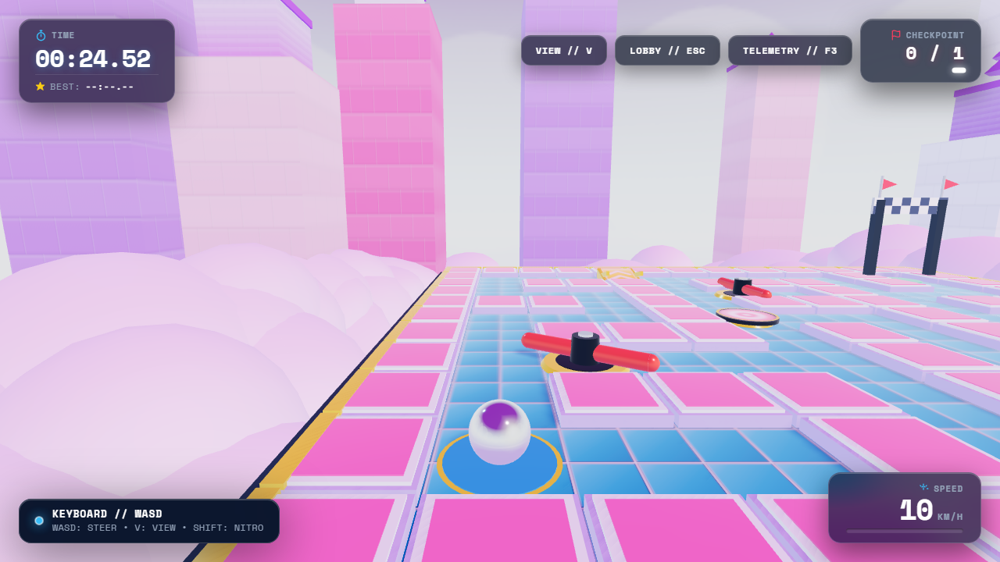
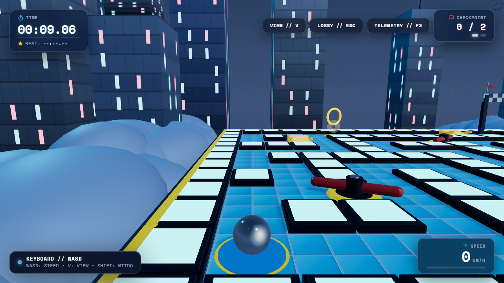
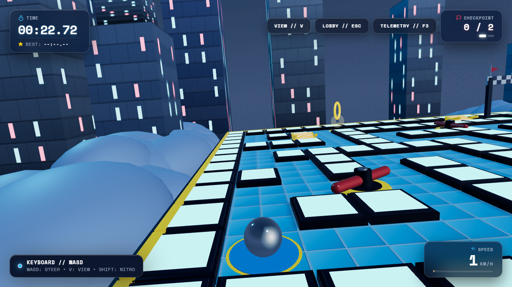

# TILTMAZE: KINETIC EDITION
### The Motion-Controlled 3D Physics Labyrinth & Telemetry Ecosystem

[](https://www.typescriptlang.org/)
[](https://threejs.org/)
[](https://rapier.rs/)
[](https://developer.android.com/)
[](https://opensource.org/licenses/MIT)

> **A phone becomes the physical tilt/shake controller for a 3D marble game running in the browser over local WebSockets.**

<!-- TODO: add docs/media/demo.gif -->

### 🔗 Quick Links
| Resource | Link |
| :--- | :--- |
| **Demo Video** | `<VIDEO_URL>` |
| **Download APK** | [GitHub Releases](https://github.com/tezz-e/tile-maze/releases) |
| **Project Page** | [docs/index.html](docs/index.html) *(enable GitHub Pages from `/docs`)* |
| **Architecture** | [docs/ARCHITECTURE.md](docs/ARCHITECTURE.md) |
| **Protocol** | [docs/PROTOCOL.md](docs/PROTOCOL.md) |
| **Latency Guide** | [docs/LATENCY.md](docs/LATENCY.md) |
| **Release Guide** | [docs/RELEASE.md](docs/RELEASE.md) |

> **Project page:** Enable GitHub Pages from `/docs` for the web showcase. (Note: the 3D physics labyrinth itself requires the local Node.js WebSocket relay server to stream live 60Hz IMU frames from the phone).

### 💡 What's the Challenge Twist?
Instead of using a standard gamepad or touchscreen joystick, **Tiltmaze turns an everyday smartphone into a real-time physical tilt instrument**. The phone streams 60Hz orientation sensor frames over a custom 20-byte binary protocol, with sub-frame latency tracking, active haptic telemetry feedback from in-game collisions, and live dual-trace oscilloscope measurement built directly into the game.

### ⚙️ How It Works



- **Calibration:** Dynamic gravity sampling over a 300ms stillness window adapts to any natural holding posture without gimbal lock.
- **Shake-to-Jump:** High-frequency linear acceleration spikes trigger a vertical impulse, hopping the marble over obstacles and floor gaps.
- **Nitro Button:** On-screen nitro button boosts board tilt limits and applies forward propulsion for rapid runs.
- **Haptic Feedback:** Physical wall collisions, hole hazards, and checkpoint dings trigger synchronized vibration waveforms on the handset.
- **Keyboard Fallback:** Full WASD / arrow-key steering, Spacebar jump, and Shift boost enable instant standalone desktop play and evaluation.

---

## 📸 In-Game Screenshots & Dynamic Skyway Environments

### Lobby & Motion Controller Pairing
<p align="center">
  
  <br><em>Nothing-inspired liquid mercury UI & live tilt indicator</em>
</p>

### Level 1: Skyway Runway (Sunny Blue Skyway)
| **Start View** | **Mid-Course Action (Boost Ramp & Spinners)** |
|:---:|:---:|
|  |  |
| *Low cream-stone curbs, cobalt sky, and distant monoliths* | *Liquid-mirror chrome marble at nitro speed launching over ramp* |

### Level 2: Serpent's Ridge (Sunset Overpass)
| **Start View** | **Mid-Course Action (Winding Chicanes)** |
|:---:|:---:|
|  |  |
| *Warm sandstone curbs, pink-peach clouds & terracotta monoliths* | *High-velocity drift around winding corners and rotor gauntlet* |

### Level 3: Twin Paths & Boosts (Dusk S-Curves)
| **Start View** | **Mid-Course Action (Nitro Ramps & Bouncers)** |
|:---:|:---:|
|  |  |
| *Light lavender curbs, rose horizon & tiered monoliths* | *Spring shortcuts, dual boost ramps, and golden checkpoint rings* |

### Level 4: Master's Labyrinth (Midnight Skyway)
| **Start View** | **Mid-Course Action (Cyber Gauntlet)** |
|:---:|:---:|
|  |  |
| *Navy-slate curbs with glowing cyan neon top edges & soft clouds* | *High-speed navigation through dark chicanes & glowing skyscraper towers* |

---

## 🌟 Key Highlights

- ⚡ **20-Byte Binary Protocol:** Streams orientation and button telemetry at 60Hz with sub-millisecond serialization over WebSocket.
- 🎯 **Rotated Gravity Engine:** Physics simulated via Rapier 3D with dynamic gravity rotation ($\vec{g}_{eff} = \mathbf{R}_{board} \cdot [0, -9.81, 0]^T$) and Continuous Collision Detection (CCD).
- 🌊 **Adaptive One Euro Filter:** Eliminates hand tremors at rest while providing instantaneous tracking during high-speed flicks.
- 📡 **LAN Smart Discovery & Session Recovery:** Automatically prunes WSL/Docker/Hyper-V virtual interfaces and preserves player slots over a 60-second disconnect grace period.
- 🔬 **Telemetry Lab & Flight Recorder:** Live dual-trace oscilloscope (Raw vs One-Euro Filtered), 3D wireframe smartphone gimbal, and real-time 20-byte hex inspector.
- 📱 **Nothing Phone (3) Hardware:** Native Jetpack Compose app with custom vibration waveforms, Google Code Scanner QR pairing, and 25×25 Glyph Matrix LED mini-map driver.
- 🎮 **Full Keyboard Fallback:** Fully playable with WASD / Arrow keys for instant desktop evaluation.

---

## 🚀 Quick Start (1-Click)

### Prerequisites
- **Node.js:** v18+ (tested on Node v24 LTS)
- **Android Phone:** Android 8.0+ (API 26+) on same Wi-Fi network

### 1. Launch Game and Server
Run `start.bat` (Windows) or execute:
```bash
# Install dependencies
npm install

# Build shared protocol & game
npm run build

# Start single-port server (Port 3000)
npm start
```
> **Platform note:** On macOS/Linux: `npm install && npm run build && npm start`. On Windows: run the equivalent or use the provided scripts (`start.bat`).

The game will automatically open at `http://localhost:3000`.

### 2. Windows Firewall (If connecting over LAN)
Run `open-firewall.bat` as Administrator to permit incoming connections on TCP port 3000.

### 3. Mobile Controller App

#### Download APK
Download the latest debug APK from [GitHub Releases](https://github.com/tezz-e/tile-maze/releases) (or build from source with `cd app && ./gradlew assembleDebug` or `.\gradlew.bat assembleDebug`).

#### Pairing & Play
1. Launch the game on your laptop (`http://localhost:3000`). The lobby screen displays your host LAN IP, port (`3000`), a 4-character room code (e.g., `6UTP`), and an interactive QR code.
2. Open the Tiltmaze app on your phone.
3. Connect using either method:
   - **QR Code Scan (Fastest):** Tap **`[ SCAN LAPTOP QR CODE ]`** and point your camera at the QR code displayed on the laptop screen (uses Google Code Scanner; zero extra permissions required).
   - **Manual Entry:** Under **`— OR MANUAL IP ENTRY —`**, enter the **`LAN IP`** shown on your laptop screen (e.g. `192.168.1.X`), verify the **`Port`** (default `3000`), type the uppercase **`4-Char Room Code (e.g. 6UTP)`**, and tap **`[ CONNECT TO RELAY // COMMENCE ]`**.
4. Once connected, tap **`[ CALIBRATE ]`** (or **`RESET FLAT`**) to set your comfortable neutral holding posture.
5. Tilt to steer the marble, shake to jump over obstacles, and hold **`NITRO`** to accelerate!

### 🔧 Troubleshooting
- **Same Wi-Fi Network:** Ensure your phone and laptop are connected to the same local Wi-Fi network.
- **Windows Firewall:** If the phone cannot connect, run `open-firewall.bat` as Administrator on Windows to permit incoming connections on TCP port 3000.
- **Use LAN IP, Not Localhost:** Always enter the laptop's actual LAN IP (e.g., `192.168.1.45`) shown on the laptop display. `localhost` and `127.0.0.1` refer to the phone itself.
- **Client Isolation / Campus / Guest Wi-Fi:** Many university and public guest networks enable AP isolation (preventing devices on the same Wi-Fi from talking to each other). If connection times out, enable your phone's personal mobile hotspot, connect your laptop to the hotspot, and re-launch `npm start`.
- **Nothing Phone Glyph Debugging:** If using a Nothing Phone with the default `"test"` key, enable the OS debug flag via ADB:
  ```bash
  adb shell settings put global nt_glyph_interface_debug_enable 1
  ```

#### Nothing Phone Glyph Matrix Setup (Optional)
If running on a Nothing Phone (3) and utilizing the 25×25 Glyph Matrix LED mini-map:
The build system injects the `NothingKey` into the manifest automatically from one of three sources (in priority order):
1. **Gradle property:** Pass `-PNOTHING_API_KEY=your_key` or set `NOTHING_API_KEY=your_key` in `~/.gradle/gradle.properties`.
2. **`local.properties`:** Add `NOTHING_API_KEY=your_key` to `app/local.properties` (untracked; see `local.properties.example`).
3. **Default development fallback:** `"test"` (Nothing's debug key).

> [!TIP]
> The default `"test"` key works when Glyph debug mode is enabled on the phone via ADB:
> ```bash
> adb shell settings put global nt_glyph_interface_debug_enable 1
> ```
> If the Glyph service or hardware is unavailable, the app keeps working seamlessly with the on-screen UI and standard vibration haptics.

---

## ⏱️ Latency & Calibration

- **60Hz Telemetry Stream:** The Android app captures orientation updates and streams 20-byte binary packets over WebSocket at a steady 60Hz period scheduled against a monotonic clock (`System.nanoTime`).
- **Drop-When-Backed-Up:** To prevent packet queuing and rubber-banding during Wi-Fi jitter, frames are dropped on the sender if the socket send queue exceeds 512 bytes, and dropped on the relay server if the host socket buffer exceeds 2KB.
- **Gravity-Relative Neutral Calibration:** Calibration samples screen-space gravity over a stillness window (~300ms) that restarts whenever motion exceeds ~3°. If no still window occurs within 800ms, the calibration is only accepted when all samples are within ~6° of their mean; otherwise the previous calibration is kept and the app shows "Hold still and tap Calibrate again".
- **Sequence Numbering & Discarding:** Telemetry packets carry an 8-bit circular sequence counter; out-of-order and duplicate packets are discarded on arrival with circular wraparound handling.

> [!NOTE]
> **Security Note:** The relay server listens on `0.0.0.0` so phones on the local area network (LAN) can connect with the 4-character room code. This is intended for trusted local networks, not public Internet exposure.

---

## ⌨️ Desktop Testing Controls (Keyboard Fallback)

If testing without a phone, use the built-in keyboard fallback:
| Key | Action |
| :--- | :--- |
| **W / Up Arrow** | Tilt board forward |
| **S / Down Arrow** | Tilt board backward |
| **A / Left Arrow** | Tilt board left |
| **D / Right Arrow** | Tilt board right |
| **Spacebar** | Shake phone / Jump |
| **Shift** | Nitro Boost |
| **C** | Calibrate Neutral posture |
| **T** | Toggle Telemetry Lab / Flight Recorder |
| **V** | Toggle Camera View (Standard vs Cinematic) |
| **Q** | Toggle Low-Quality Mode (Performance Guard) |

---

## 📁 Repository Structure

```text
tiltmaze-kinetic/
├── package.json                    # Workspace root (scripts: dev, build, start, test)
├── start.bat                       # 1-click startup
├── open-firewall.bat               # Windows Firewall port 3000 helper
├── local.properties.example        # Android SDK and Nothing Developer key example
├── LICENSE                         # MIT License
├── docs/
│   ├── ARCHITECTURE.md             # In-depth architectural design
│   ├── PROTOCOL.md                 # 20-Byte binary & JSON schemas
│   ├── LATENCY.md                  # NTP clock sync math & 240fps slow-mo camera guide
│   ├── DECISIONS.md                # Record of architectural choices
│   └── planning/                   # Architecture planning and specification documents
├── packages/
│   └── protocol/                   # Shared TypeScript protocol & 20-byte codec
│       ├── src/binaryCodec.ts      # DataView encoder & decoder
│       └── src/controlMessages.ts  # JSON message types
├── server/                         # Ultra-thin Node.js + ws relay & static server
│   ├── src/index.ts                # Express/HTTP + WebSocket server on port 3000
│   ├── src/RoomManager.ts          # 4-char codes, 2-player slots, 60s session recovery
│   ├── src/networkDiscovery.ts     # Prunes WSL/Docker/vEthernet, detects primary LAN IP
│   └── src/ntpSync.ts              # NTP 4-timestamp latency & RTT estimator
├── game/                           # Vite + TypeScript + Three.js + Rapier 3D
│   ├── src/main.ts                 # Game loop, rendering, physics sync
│   ├── src/physics/                # Rapier 3D world, rotated gravity, CCD marble
│   ├── src/world/                  # 3D labyrinth board, holes, checkpoints
│   ├── src/levels/                 # 4 progressive levels + BFS solvability validators
│   ├── src/audio/                  # Web Audio synthesized sound generator
│   └── src/ui/                     # Lobby, QR code, Game HUD, Telemetry Lab
└── app/                            # Native Android App (Kotlin + Jetpack Compose)
    ├── gradlew / gradlew.bat       # Gradle build wrapper
    ├── settings.gradle.kts         # Root Gradle build settings
    └── app/
        ├── libs/glyph-matrix-sdk-2.0.aar # Nothing Glyph Matrix SDK AAR
        ├── src/main/java/com/tiltmaze/
        │   ├── MainActivity.kt     # Compose UI & QR Scanner
        │   ├── sensor/             # 100Hz GameRotationVector, LinearAccel, OneEuroFilter
        │   ├── net/                # OkHttp WebSocket, 20-byte binary streamer
        │   ├── haptics/            # Custom VibrationEffect waveforms
        │   ├── glyph/              # Nothing Phone (3) 25x25 Glyph Matrix driver & math
        │   └── ui/                 # Cockpit HUD controller screen & brutalist theme
        ├── src/test/java/          # JUnit tests for Glyph math, smoothing, and backoff
        └── AndroidManifest.xml
```

---

## 🧪 Verification & Automated Testing

Run all unit tests across all workspace packages:
```bash
npm test
```
*(Windows: `npm test` or `npm.cmd test`)*

- **Protocol Tests:** Encodes/decodes 20-byte binary frames, tests little-endian float stability, and bitmask flags.
- **Server Tests:** Verifies 4-character room codes, 2-player slot capacity, 60-second disconnect recovery, and LAN interface ranking.
- **Game Tests:** Automated BFS graph solver testing every single level to mathematically prove solvability from start to finish without hazard intersection.
- **Filter Tests:** Verifies that the One Euro Filter suppresses micro-tremors at rest while maintaining instant response on fast flicks.

Run Android JVM unit tests:
```bash
cd app && ./gradlew testDebugUnitTest
```
*(Windows: `cd app; .\gradlew.bat testDebugUnitTest`)*
- **Android Tests:** Verifies circular matrix geometry (489 physical LEDs), radial vector clamping, sub-pixel Gaussian blob balance, exponential smoothing convergence, and reconnect backoff progression.

---

## 📄 License & Third-Party Notices
- **Project License:** [MIT License](LICENSE) — Copyright (c) 2026. Created for the "Anything but a Game Controller" Challenge.
- **Third-Party Libraries:** The Android controller app integrates Nothing Technology Limited's Glyph Matrix SDK binary AAR for rear LED matrix support. See [app/app/libs/README.md](app/app/libs/README.md) for licensing terms and official developer portal links.
